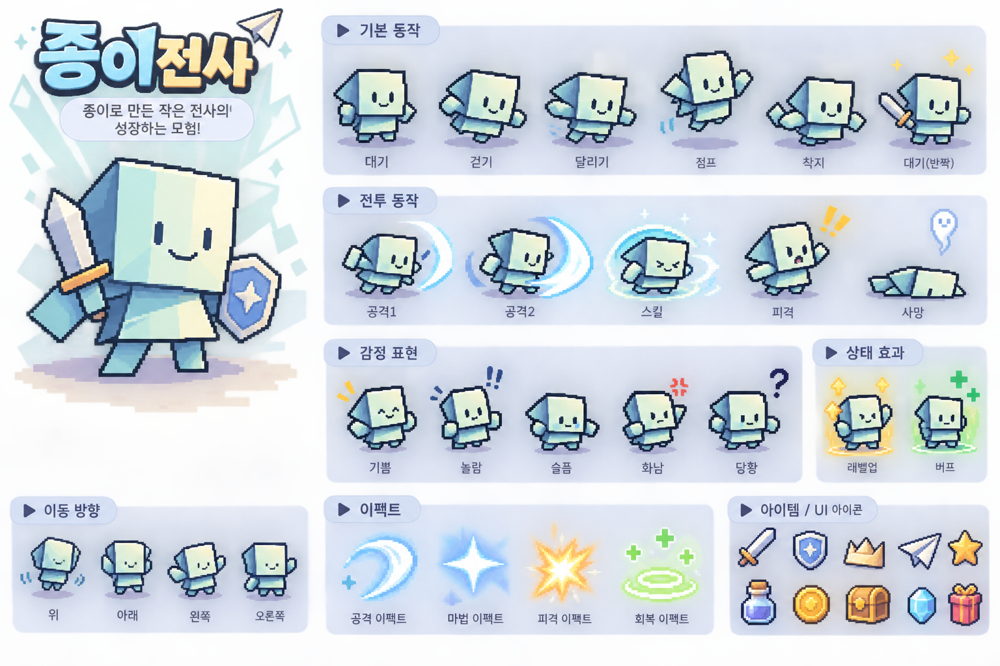

# 종이전사 아트 가이드

> 이 문서는 종이전사 기획서 v2.0의 시각 규칙을 제작 에이전트가 빠르게 적용할 수 있도록 정리한다. 수치 중 후보로 표시된 항목은 제작·화면 테스트 후 확정한다.

## 기준 콘셉트



위 이미지는 캐릭터 디자인과 애니메이션/아이콘 방향을 보여주는 **참고용 콘셉트 시트**다. 시트 이미지를 게임 에셋으로 직접 사용하지 않는다. 실제 적용 전에 캐릭터 및 개별 프레임을 분리하고 투명 배경, 캔버스 크기, 팔레트, 앵커, 프레임 순서를 검수한다.

## 캐릭터 디자인 규칙

| 요소 | 규칙 |
|---|---|
| 머리/몸통 | 기울어진 접힌 머리와 삼각 종이 몸통. 실제 형태는 `warrior_key_art.svg`를 우선하며 이 표를 근거로 다시 그리지 않음 |
| 얼굴 | 작은 세로 눈 2개와 짧은 미소. 감정은 눈·입·기호만 최소 변경 |
| 팔다리 | 접힌 종이 조각처럼 각진 실루엣. 관절을 과도하게 세분화하지 않음 |
| 비율 | 큰 머리/몸통, 짧은 팔다리의 치비 비율. 작은 화면에서도 표정이 보여야 함 |
| 색상 | 민트, 청록, 하늘색, 크림색 중심. 강한 형광색은 피함 |
| 외곽선 | 짙은 남청색 계열로 배경과 명확히 분리 |
| 종이 표현 | 픽셀 가독성을 유지하는 범위에서 접힌 면, 종이 그림자, 하이라이트를 사용 |

기준 실루엣과 얼굴 비율을 고정해 생성물 간 일관성을 유지한다. AI 생성 결과는 초안으로만 취급하며 프레임 분리, 투명 배경, 크기 정규화, 팔레트 검수를 거친다.

## 애니메이션 우선순위

방치형 전투에서는 이동보다 대기·공격·피격 동작의 품질이 중요하다. 기획서의 MVP 우선 동작은 대기/기본 이동, 공격 1종, 피격이다. MVP에서 먼저 만들 3개 동작은 이 핵심 루프를 가리킨다.

| 분류 | MVP | 후속 |
|---|---|---|
| 기본 | 대기, 걷기 또는 제자리 이동 | 달리기, 점프, 승리 |
| 전투 | 공격 1종, 피격 | 연속 공격, 스킬, 회피, 사망/부활 |
| 표정 | 기본, 기쁨 | 놀람, 슬픔, 화남, 당황 |
| 상태 | 레벨업, 버프 표시 | 디버프, 회복, 희귀 드롭 연출 |

프레임 간 캐릭터 중심점과 발 위치를 정렬해 흔들림을 방지한다. 동작별 프레임 크기는 동일하게 유지하고 프레임 순서를 명시한다.

## 에셋 규격 초안

| 에셋 | 시작 규격 후보 | 관리 규칙 |
|---|---|---|
| 기본 캐릭터 | 64×64 또는 96×96 픽셀 | 화면 크기 테스트 후 하나로 확정 |
| 애니메이션 | 동작별 스프라이트 시트 | 프레임 크기 동일, 프레임 순서 표시 |
| 아이콘 | 32×32 또는 48×48 픽셀 | 장비·재료·상태 아이콘에 공통 적용 |
| 이펙트 | 32×32~96×96 픽셀 | 효과별 개별 시트 |
| 배경 | 화면 비율 기반 타일/레이어 | 반복 가능한 요소 우선 |

위 크기는 시작 가이드다. 최종 해상도와 화면 배율 확정 후 전체 에셋 규격을 일괄 적용한다.

## 캐릭터 레이어 순서

| 순서 | 레이어 | 예시 |
|---:|---|---|
| 1 | 후면 이펙트 | 오라, 반짝임 |
| 2 | 등/망토 장식 | 망토, 날개, 등 장식 |
| 3 | 기본 캐릭터 | 머리/몸통/팔/다리 |
| 4 | 머리 장식 | 왕관, 리본, 꽃 |
| 5 | 스티커/문양 | 볼 홍조, 별, 낙서 |
| 6 | 전면 이펙트 | 레벨업 빛, 공격 효과 |

외형 아이템마다 전신 스프라이트를 새로 만들지 않고 캐릭터 파츠 레이어를 재사용한다. 꾸미기는 전투 능력치와 분리한다.

## 파일명과 메타데이터

파일명은 용도와 동작을 식별할 수 있게 소문자 스네이크 케이스로 작성한다.

```text
warrior_idle_01.png
warrior_attack_01.png
hat_paper_crown.png
effect_levelup_01.png
```

에셋 메타데이터에 다음 필드를 기록한다.

| 필드 | 의미 |
|---|---|
| `asset_key` | 프로젝트 내 고유 식별자 |
| `category` | 캐릭터, 몬스터, 장비, 이펙트 등 분류 |
| `slot` | 장착 위치 또는 대상 슬롯 |
| `frame_size` | 애니메이션 프레임의 너비·높이 |
| `frame_count` | 시트에 포함된 프레임 수 |
| `anchor` | 캐릭터 기준점 |
| `layer_order` | 겹침 순서 |
| `rarity` | 아이템 등급 |
| `unlock_source` | 획득 경로 |

## 폴더 분류

```text
assets/
├── characters/warrior/
├── monsters/
├── equipment/
├── decorations/
├── backgrounds/
├── effects/
├── icons/
└── audio/
```

관련 문서: [게임 기획서](GAME_DESIGN.md), [기술 설계](TECHNICAL_DESIGN.md).

## 웹·시작 화면 프레젠테이션

웹사이트와 시작 화면은 **종이 공작 동화**를 방향으로 잡는다. 크림색 종이(`#f7f4e9`), 민트색 종이(`#cce4d8`), 하늘색(`#d3e6ee`), 따뜻한 노랑(`#f2cd7e`), 짙은 청색 잉크(`#2d495b`)를 사용한다. 접힌 모서리, 마스킹테이프와 메모, 스티커, 작은 종이 비행기를 활용하고 어두운 터미널/대시보드 스타일은 사용하지 않는다. 참고 사이트에서는 배치 원칙만 참고하며 색상·브랜딩·카드 디자인을 그대로 재현하지 않는다.

웹 게임은 기본적으로 중앙의 작은 세로형 3:4 프레임에 표시하며 위에는 제목, 아래에는 체험 범위와 설명을 둔다. 높이가 짧은 가로 화면에서는 16:9와 맵/사이드 메뉴 배치를 사용한다. 랜딩의 전사는 기술 정보 카드 안에 넣지 않고 밝은 민트/하늘색 종이 형태 위에 독립적으로 배치한다.

`assets/characters/warrior/warrior_key_art.svg`는 큰 얼굴, 접힌 면, 작은 검과 별 방패를 표현한 정상 정적 키 아트다. 원본 파일은 보호하고 랜딩페이지에 사용한다. 캐릭터 공통 부품은 이 원본의 도형/색상을 그대로 분리한 것이며 첨부 콘셉트 시트를 잘라 사용하지 않는다. 미배포 품질 복구 작업에서 Splash는 로고/종이 배경, 웹 부팅은 파일 준비 패널, Loading은 하늘색 작업대와 종이 접기 UI, Title은 로고/기준 PNG 대기 전사와 시작 버튼으로 구분한다.

`assets/backgrounds/paper_forest_preview.svg`는 하늘색과 접힌 민트 종이 나무로 만든 미리보기 배경이다. 작은 전사가 맵을 둘러보는 동안 가짜 적 HP나 보상 대신 **전투 준비 중** 상태를 표시한다.

| 메타데이터 | 값 |
|---|---|
| `asset_key` | `warrior_key_art` |
| `category` | 프레젠테이션 / 정적 키 아트 |
| `slot` | 랜딩페이지의 프로모션 이미지 |
| `frame_size` | SVG viewBox 480×420, 비율 유지 스케일링 |
| `frame_count` | 정적 원본 1장 |
| `anchor` | 이미지 중앙 |
| `layer_order` | 배경 위, 제목/버튼 아래 |
| `rarity` | 해당 없음 |
| `unlock_source` | 시작 시 표시 |

### 픽셀 전사 및 제작 정책

전체 표준은 [캐릭터 스프라이트 제작 지침](CHARACTER_SPRITE_STANDARD.md)에 기록한다. 공통 `warrior_parts.svg`와 애니메이션별 `warrior_animation.json`에서 시트/PNG/씬을 생성한다. 프레임별로 외형을 복제하지 않아 공통 부품 수정이 모든 동작에 반영된다.

| 메타데이터 | 픽셀 전사 | 로딩 종이 |
|---|---|---|
| `asset_key` | `warrior_idle_walk` | `paper_fold` |
| `category` | 캐릭터 / 프레젠테이션 | UI / 준비 연출 |
| `source` | 보호된 정상 SVG 도형 → 공통 부품 + JSON 동작 데이터 | 픽셀 SVG 마스터 |
| `runtime` | 투명 RGBA PNG, Nearest | SVG import 텍스처, Nearest |
| `frame_size` | 원형 보존 예외 96×96, 가로 10칸 | 24×24, 가로 4칸 |
| `frame_count` | Idle 4, Walk 6 | Fold 4 |
| `anchor` | 중심 x=48, 발 기준선 y=88 | 프레임 중심 (12,12) |
| `layer_order` | 맵 위 / 화면 UI 아래 | 로딩 배경 위 |
| `unlock_source` | 시작 시 표시, 전투 기능 아님 | 리소스 준비 화면 |

Attack 5~6·Hit 2~3·Death 4~6·Victory 4~6프레임은 향후 제작 기준이며 현재 에셋/전투 구현 완료를 뜻하지 않는다. SVG는 수정 가능한 마스터와 프로토타입에 허용하되 최종 캐릭터는 PNG를 기본으로 하며 실제 SVG/PNG 렌더링과 확대 품질을 비교한다.

정상 전사의 잉크 `#263b50`과 기존 종이/방패 색·그라데이션은 UI 팔레트에 맞춘다는 이유로 바꾸지 않는다. 변경 이유, 복구 태그, 동일 조건 전후 비교는 [품질 복구 기록](VISUAL_QUALITY_RECOVERY.md)에 남긴다. 48px 기본 규격과 현재 96px 예외를 혼동하지 않는다.

### 로고와 파비콘

`assets/branding/`의 로고 심볼은 첨부 캐릭터 방향을 참고해 생성한 **접힌 종이 얼굴**이다. 원본 `logo_symbol_source.png`(1254×1254, 투명 배경)를 보존하고, 불투명 영역 기준 정렬/패딩을 조정해 `logo_symbol.png`(512×512)를 제작했다. `logo_wordmark.png`(704×224)는 이 심볼과 Galmuri의 종이전사/PAPER WARRIOR 글자를 합성한 투명 배경 로고다.

`favicon_16.png`, `favicon_32.png`, `favicon_48.png`, 세 크기를 담은 `favicon.ico`, `apple_touch_icon.png`(180×180)를 제공한다. 웹 헤더·탭 아이콘·모바일 홈 아이콘 및 Godot 게임 창 아이콘에 적용한다. 로고는 정적 브랜딩 에셋이며 캐릭터 전투 스프라이트로 사용하지 않는다. 생성 원본은 게임 패키지에서 제외한다.

## 글꼴

| 용도 | 글꼴 | Godot 테마 |
|---|---|---|
| 게임 제목/픽셀 강조 | Galmuri 11 Bold (아웃라인) | `assets/fonts/theme_galmuri.tres` |
| 버튼과 일반 UI | Pretendard Regular | `assets/fonts/theme_ui.tres` |

원본 글꼴 파일과 각각의 SIL Open Font License 전문(`LICENSE-Galmuri.txt`, `LICENSE-Pretendard.txt`)을 함께 보존한다. 웹 Export 후 한글 글리프와 글꼴 적용을 브라우저에서 확인한다.
