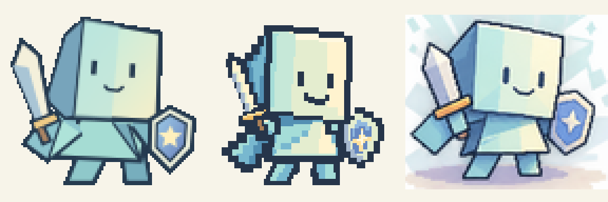
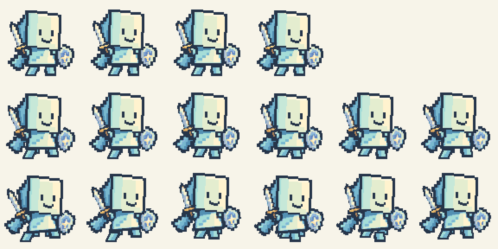
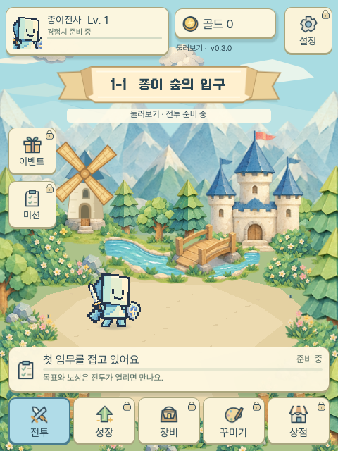
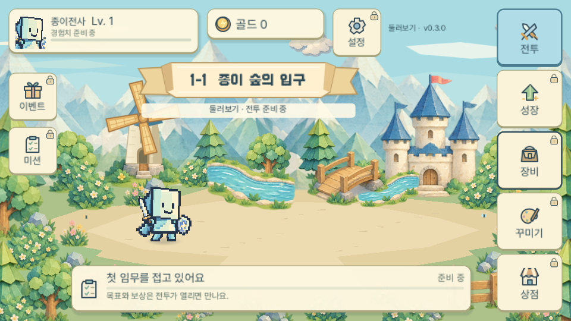
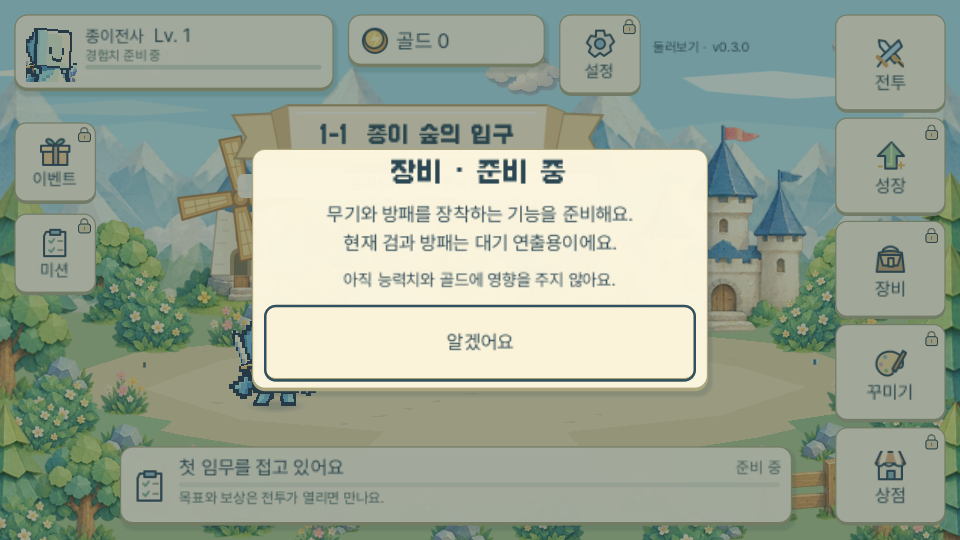

# 콘셉트 전사 복원과 살아 있는 종이 숲

## 승인 범위와 복구

사용자가 `paper-warrior-concept-sheet.png`를 새 캐릭터 기준으로 명시하고 얼굴·몸통과 다리 연결을 상세하게 수정하도록 요청했다. 이전 SVG를 임의로 바꾸지 않는 원칙의 이번 예외이며, 구 프로필은 삭제하거나 덮어쓰지 않는다. 복구 태그는 `backup/concept-world-20261111-d2e469e`다.

마지막 요청에서 제외한 캐릭터 크기·위치 변경은 적용하지 않는다. 전투·보상·저장 시스템도 추가하지 않는다. 현재 버전 0.3.0을 유지하고 공개 배포하지 않는다.

## 선택한 설계

기존 전사에 외곽선만 더하면 컨셉의 얼굴·비율·접힘 차이가 남는다. 이미지를 매 프레임 새로 생성하면 외형과 관절이 흔들린다. 따라서 **새 공통 SVG 부품 + JSON 동작 + 최종 PNG** 프로필을 선택한다.

- 크림/민트 정면과 파란 접힌 측면을 가진 큰 사각 머리, 짧은 세로 눈과 미소, 짧고 넓은 접힌 옷, 종이 망토와 별 방패를 기준으로 한다.
- 몸통 옷자락이 양쪽 다리의 뿌리를 덮도록 구성한다. 고정된 골반/어깨 연결점에서 움직이고, 프레임 사이 목·허리 틈이나 떠 있는 다리가 생기지 않아야 한다.
- 96px 프레임, 대기 4·걷기 6·달리기 6을 독립 관리한다. 장비는 손의 변형을 따라가며 얼굴은 머리와 함께 유지한다.
- 발밑 그림자는 PNG에 굽지 않고 별도 부드러운 타원 노드로 그려 Title/맵에서 같은 발 기준점을 따른다. 캐릭터 외곽선은 짙은 남청색 도트로 강화한다.
- 배경은 기존 독립 소재를 보존하고 구름의 느린 왕복, 밑동 기준 수목 흔들림, 작은 물빛/나비를 추가한다. 풍차 날개는 몸체와 분리해 실제 허브 중심에서 회전한다.
- 배경은 하나의 시간값으로 절제된 진폭을 유지하며 리사이즈 시 현재 시간을 보존한다. 게임 데이터와 애니메이션 연출을 섞지 않는다.

## 구현·검증 계획

1. 기존 원본 보호와 실패 검사: 움직이지 않는 배경에서 새 동작 검사가 실패하는 것을 확인한다.
2. 새 캐릭터 프로필/생성기/전용 회귀 검사와 배경 움직임을 독립 변경한다.
3. Title/맵/프로필을 새 PNG로 연결하고 기존 대기/이동·방향 전환·메뉴를 유지한다.
4. 확대 프레임과 실제 애니메이션에서 얼굴·관절·발 접지·장비와 풍차 축을 확인한다.
5. 창 모드 GdUnit, Node, Web PCK, 실제 Chrome 양방향/PC에서 결과와 콘솔을 확인한다.
6. 실제 실행 결과·사진·미검증 범위를 기록한다. 컨셉 이미지와 똑같다고 검증 없이 단정하지 않는다.

## 구현 결과

### 얼굴과 몸통·다리 연결

구 PNG는 원본 SVG 도형을 보존한 프로필이라 컨셉 재해석을 위한 관절·달리기 데이터가 없었다. 이를 덮어쓰는 대신 `concept_pixel_96` 프로필을 추가했다. 컨셉의 입체적인 종이 머리와 접힌 옷을 제한된 도트 팔레트로 해석한 것으로, 참조 이미지와 픽셀 단위로 동일한 복제는 아니다.

- 얼굴 정면의 오른쪽을 조금 낮추고 오른쪽 눈도 1px 낮춰 같은 면 위에 보이도록 했다. 미소의 위치와 크림/민트 면, 파란 측면 접힘을 공통 부품에서 관리한다.
- 목깃은 얇게 겹쳐 연결하고, 옷자락이 허벅지 뿌리를 덮는다. 허벅지와 부츠도 겹쳐 걷기·달리기에서 다리가 떨어져 보이지 않도록 했다.
- 왼발은 아래왼쪽으로 뻗은 종이 접힘과 밝은 면을 추가했다. 접지 기준선은 88px이며 달리기의 공중 프레임만 기준선 위에 뜬다.
- 머리와 얼굴, 양손과 장비는 각각 같은 변형을 공유한다. 16프레임의 얼굴 ROI·눈/미소 샘플, 몸통/허벅지/부츠의 실제 마스크 겹침을 검사한다.
- 최종 PNG는 1536×96, 투명/불투명 알파만 사용하는 14색이다. 대기 4@4fps, 걷기 6@8fps, 달리기 6@12fps이며 모두 Nearest다.
- 기존 맵 경로·배율·위치는 유지한다. 한 경로 구간에만 빠른 달리기를 표시하고 정지 시 대기로 전환한다. 전투나 플레이어 조작을 추가한 것은 아니다.

동일한 크림 배경·96px 프레임의 비교: **왼쪽 구 원형 / 가운데 새 도트 프로필 / 오른쪽 컨셉 참조 크롭**.

확대 프레임: 위부터 대기 4 / 걷기 6 / 달리기 6. 대기 행의 빈 두 칸은 추가 프레임이 아니다.

### 그림자와 배경 움직임

발 그림자는 발 기준점에 고정된 12개 저알파 타원으로 가장자리를 부드럽게 했다. 그림자는 캐릭터 PNG와 별개라 머리·옷의 움직임에 따라 찌그러지지 않는다. 남청색 도트 외곽선과 밝은 종이 면으로 배경 대비를 확보했다.

구름은 느린 왕복, 수목·꽃·관목은 밑동 기준의 작은 회전, 강에는 네 개의 물빛, 꽃 근처에는 작은 나비 두 마리를 더했다. 풍차는 원본 PNG를 보존하고 몸체/날개를 분리해 허브 중심에서 회전한다. 화면 회전 시 배경 오브젝트를 재배치하되 연출 시간은 초기화하지 않는다.

[실제 웹 캔버스의 10초 움직임 영상](images/concept-world/world-motion.webm)

## 변경 파일

| 구분 | 주요 파일 |
|---|---|
| 새 캐릭터 원본/동작 | `assets/characters/warrior/concept_parts.svg`, `data/presentation/concept_warrior_animation.json`, `scripts/art/build_concept_warrior.gd` |
| 생성물/공통 씬 | `concept_idle_walk_run.svg`, `concept_idle_walk_run.png`, `concept_preview_4x.png`, `scenes/characters/concept_warrior.tscn` |
| 그림자/연결 | `scripts/ui/warrior_shadow.gd`, `map_walker.gd`, `scenes/ui/{map_walker,warrior_idle,player_profile}.tscn` |
| 배경 연출 | `scripts/ui/paper_background.gd`, `world_ambience.gd`, `scripts/art/build_world_motion.gd` |
| 풍차 분리 소재 | `assets/backgrounds/paper_forest_diorama/source/windmill_{roof_body,sails}.svg`, `windmill_body.png`, `windmill_sails.png` |
| 검사/내보내기 | `tests/gui/ConceptSpriteTest.gd`, `LivingWorldTest.gd`, `GameScreenTest.gd`, `tests/export/StartupLayoutCheck.gd`, `export_presets.cfg` |
| 지침/기록 | Copilot 규칙, README, CHANGELOG, 캐릭터 제작/아트/기술/작업 문서 및 이 보고서 |

기존 `warrior_key_art.svg`, 구 부품/PNG/JSON/생성기/캐릭터 씬은 변경하지 않았다. 편집용 SVG·JSON·미리보기·문서 이미지는 게임 패키지에 넣지 않는다.

## 실제 실행 결과

| 검사 | 실제 결과 |
|---|---|
| Godot 4.4.1 에디터 import | 오류·경고 없음 |
| 생성기 `--check` | 16프레임 일치, 얼굴·허리·손/장비 연결·기준선·팔레트 검사 통과 |
| 창 모드 GdUnit4 | 31/31, 오류/실패/flaky/skip/orphan 0 |
| Node 웹 회귀 검사 | 13/13 |
| 최종 Web Export/PCK | Splash → Loading → Title → Game, 새 PNG/달리기/그림자/풍차 리소스 확인 |
| 실제 Chrome 모바일 에뮬레이션 | 390×844, DPR2; 시작·일곱 메뉴·ESC·가로/세로 왕복, 같은 Engine 1개·메뉴 상태 유지 |
| 실제 Chrome PC | 1440×1000, DPR1; 시작·일곱 메뉴·ESC·방향 왕복 확인 |
| 브라우저 오류/포커스 | 예상 밖 런타임 오류 없음, 클릭 outline 없음, 입력 포커스 자체는 유지 |
| 실제 애니메이션 | 10초 캔버스 녹화, 확대 시트·실제 크기 렌더링과 시간별 배경 위치 검사 |

실행 방법은 README의 Godot/GdUnit/Node/Web 명령을 사용한다. 재생성은 `build_concept_warrior.gd`, 풍차 소재는 `build_world_motion.gd`로 수행한다. 로컬 웹 주소는 <http://localhost:8000/play.html>이다.

### 최종 화면

[실제 모바일 웹 전체 화면](images/concept-world/web-mobile.png) · [실제 PC 웹 전체 화면](images/concept-world/web-desktop.png) · [실제 장비 준비 안내](images/concept-world/web-equipment.png)

## 버전과 남은 범위

- 현재 버전: **0.3.0 유지**. 앞선 신규 메뉴를 포함한 묶음 업데이트의 제안은 **0.4.0 / MINOR**이며 승인·확정·공개 배포하지 않았다. 이번 얼굴·관절·연출 개선만 분리하면 PATCH 성격이다.
- 기존 레벨·골드·스테이지 표시와 메뉴·시작 흐름에 연결했으며 저장 데이터/게임 규칙은 변경하지 않았다.
- 실제 몬스터·HP·전투·공격/피격/사망·목표/보상·성장은 미구현이다. 따라서 전투 사진이나 작동하는 성장/장비 시스템으로 보고하지 않는다.
- 실제 휴대전화, iOS/Safari, 이번 변경의 Windows 배포 패키지와 공개 배포 페이지는 검사하지 않았다. 공개 사이트는 이전 버전이며 이번 결과는 로컬 웹/소스 브랜치다.
