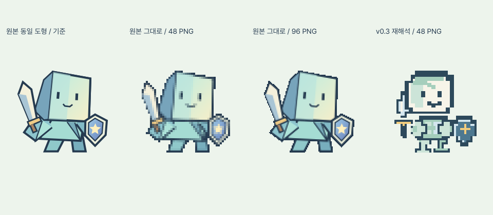
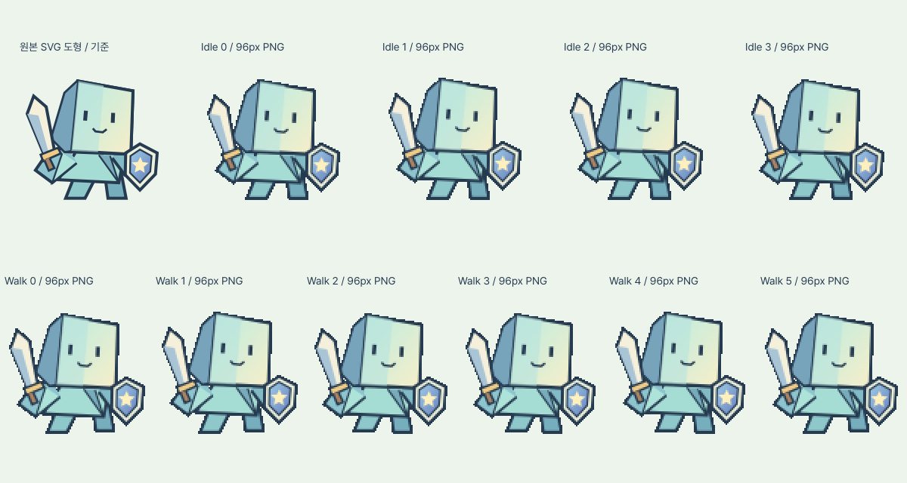

# 화면 및 캐릭터 품질 복구 조사·작업 기록

## 1. 수정 전 조사와 원인

조사 기준은 `socra710`의 `9fdf5c1` / 공개 v0.3.0이다. Godot 4.4.1 Compatibility, GDScript, GdUnit4 v5.1.1과 기존 Web/Windows 빌드·별도 배포 저장소 구조를 유지한다.

`project.godot`의 실제 시작 씬은 `scenes/main/splash.tscn`이다. `splash.gd`가 1.2초 뒤 Loading으로 이동하고 `loading.gd`가 실제 Title/Game 요청을 준비한다. Title은 준비된 Game을 사용하며 중복 시작 방지, 오류 후 재시도/재실행 기능은 유지 대상이다.

### 화면 구분

- Splash와 Title이 `scenes/ui/start_screen.tscn`을 함께 상속한다. 이름/구도가 거의 같고 Splash는 같은 전사를 서서히 표시한다.
- Godot Loading은 별도 씬이며 실제 `ResourceLoader` 준비 상태를 읽는다. 같은 씬을 재사용하는 것은 아니다.
- 하지만 **Godot 실행 전 웹 다운로드 오버레이**도 큰 게임 제목과 같은 전사를 사용한다. 사용자가 먼저 보는 다운로드 화면이 Splash/Title과 비슷한 것이 실제 혼동 원인이다.
- Loading은 빈 progress 배열도 0%처럼 표시하고, 진행 중 요청이 1.0을 보고하면 완료되지 않아도 합계 100%가 될 수 있다. 불확정 상태와 최종 완료를 분리해야 한다.
- 각 씬의 세로 480×640 / 가로 960×540 렌더를 저장했다. 로딩의 빠른 통과를 디자인이 구분된다는 근거로 사용하지 않는다.

### 캐릭터 회귀

`warrior_key_art.svg`는 `2753978`(v0.2.0)과 현재 사이에 변경이 없다. 정상 참조를 그대로 보유하고 있다.

`319f0d0`에서 새 `warrior_parts.svg`/PNG 시트를 추가하면서 도형을 재해석했다. 원본의 기울어진 접힌 머리, 삼각 종이 몸통, 비스듬한 검, 오각 별 방패가 사각 머리·분절 몸통·수직 검·십자 장식으로 바뀌었다. 이는 파일 형식 전환 문제가 아니라 **외형 재작성과 팔레트 교체**다. 48px의 큰 상대 이동과 눈 감기 변형도 외형 변화 인상을 강화한다.

동일 배경/192×192 표시 영역에서 원본 도형, 원본의 48px/96px PNG 후보, v0.3 PNG를 비교했다. 48px 원본 변환은 눈·접힘·별이 손상됐다. 96px 후보는 원본 비율과 장비 형태를 더 잘 유지한다.



## 2. 복구 지점과 원본 보호

후속 버전 정책에 따라 이번 품질 개선은 `0.3.1` PATCH **제안**으로 분류한다. `quality-v040` 경로와 아래 복구 태그의 `v0.4.0`은 당시 작업 식별자이지 확정 버전이 아니다. 사용자 승인 전 새 릴리스 확정·공개 배포를 하지 않는다. [버전 관리 정책](VERSION_POLICY.md)을 우선한다.

- 작업 전 복구 태그: `quality-before-v0.4.0` → `9fdf5c1`.
- 정상 참조 태그: `character-reference-v0.2.0` → `2753978`.
- `warrior_key_art.svg`의 도형/색상/그라데이션을 직접 수정하지 않는다.
- 캐릭터 변경과 화면 변경은 별도 커밋으로 분리한다. 게임 시스템은 추가/제거하지 않는다.
- 기존 v0.3 외형은 복구 태그에 보존한다. 새 후보가 원본 충실도를 개선하지 못하면 정상 참조 방식을 유지한다.

## 3. 비교한 접근과 수정 계획

1. **원본 SVG 직접 복원:** 외형 보존이 가장 확실하지만 걷기 프레임과 PNG 기본 제작 흐름이 후퇴한다.
2. **원본 도형 그대로 PNG 생성 — 선택:** 공통 부품의 도형/선/색을 정상 SVG와 일치시키고 작은 위치 이동만 데이터로 관리한다. 확대 비교에서 더 충실한 **96×96 예외**를 사용하되 실제 표시 크기는 기존과 동일하게 줄인다. 48px 기본 규격을 무조건 적용해 외형을 훼손하지 않는다.
3. **새 픽셀 캐릭터 재디자인:** 이번 요청에 어긋나므로 제외한다.

### 캐릭터 변경 단위

- 공통 부품 SVG에 정상 원본의 경로를 그대로 분리하고 원본과의 대응을 기록한다.
- 생성기/동작 JSON은 96×96, 고정 중심/발 기준선, Idle 4 / Walk 6을 사용한다.
- 얼굴/머리/장비의 프레임별 재해석, 눈·입 교체와 신체 스케일 변형을 제거한다. 대기는 미세한 평행 이동만 사용한다.
- 맵은 총 72px 프레임, Title 미리보기는 총 144px로 유지한다. 파일 해상도와 화면 표시 크기를 혼동하지 않는다.
- 투명 PNG와 Nearest는 유지한다. 정상 원본의 색을 v0.3의 다른 7색으로 재매핑하지 않는다.

### 화면 변경 단위

- **웹 다운로드:** 전사/대형 로고를 제거한 파일 준비 패널. 실제 바이트 또는 불확정 상태와 오류/재시도만 표시한다.
- **Splash:** 독립 Control 씬. 종이 접힘 배경과 실제 로고, 짧은 인트로. 진행률/로딩 재시도 UI는 두지 않는다. 전환 실패 시 로고 화면에 오류를 남긴다.
- **Loading:** 독립 리소스 준비 화면. 종이 UI 애니메이션과 작업 상태를 중심으로 배치한다. 알 수 없는 진행률은 불확정, 준비 중은 최대 99%, 모든 요청이 완료된 때만 100%다.
- **Title:** 로고·기준 캐릭터·모험 시작 버튼. 기존 준비된 Game 소비, 오류 복구와 키보드 접근성을 유지한다.
- **Game:** 기존 HUD/메뉴/작은 맵 이동은 유지한다. 전투·성장·보상·저장을 새로 구현하지 않는다.
- 버튼/글꼴/테두리는 공통 테마로 관리하고 화면 전체를 재사용해 구도가 같아지지 않게 한다.

### 예정 파일과 실행·검증

캐릭터: `assets/characters/warrior/warrior_parts.svg`, `data/presentation/warrior_animation.json`, `scripts/art/build_warrior_sprites.gd`, 생성 시트/씬, `scenes/ui/warrior_idle.tscn`.

화면: `scenes/main/splash.tscn`, `scripts/main/splash.gd`, Loading 씬/스크립트, Title 전용 레이아웃, 공통 버튼 테마, `web/play.html`, 로더 CSS/JS 및 `scripts/web/build.mjs`.

회귀 검사: 기존 GdUnit/Node/export 검사를 유지하고 화면 독립성, Splash 실패/중복 방지, 알 수 없는 진행률, 미완료 100% 방지, 캐시 버전 구분을 추가한다.

```powershell
godot --headless --path . --script res://scripts/art/build_warrior_sprites.gd
godot --headless --editor --path . --import
godot --path . -s res://addons/gdUnit4/bin/GdUnitCmdTool.gd -a res://tests
node --test tests\web\*.test.mjs
node scripts\web\build.mjs "C:\Tools\Godot\Godot_v4.4.1-stable_win64_console.exe"
```

수정 전후 씬 사진은 같은 480×640 / 960×540 창에서 저장한다. 로딩 UI 사진은 통제된 백엔드의 미리보기이며 실제 콜드 시작과 실패/재시도는 별도로 실행한다. 웹은 엔진/PCK 실패, 반복 부팅, 방향 변경, 콘솔/게임 로그와 이전 배포 캐시를 확인한 후 새 버전으로 게시한다. 수행 전 검사를 통과로 기록하지 않는다.

## 4. 실제 결과

### 발견한 문제와 수정

| 원인 | 실제 수정 |
|---|---|
| Splash/Title 공통 구도와 웹 다운로드 화면의 같은 제목/전사 | Splash를 독립 로고 씬으로 분리. 다운로드는 파일 패널, Loading은 하늘색 작업대, Title은 로고/기준 전사/버튼 |
| 빈 progress를 0%로 처리, 진행 중 1.0도 100%로 표시 | 불확정 상태를 사용하고 미완료 값은 99% 상한. 두 요청 완료 시에만 100% |
| 원본을 분석하지 않고 다른 머리/몸통/검/방패와 팔레트로 다시 제작 | 정상 원본 20개 경로·선 속성·두 그라데이션을 공통 부품으로 복원. 얼굴 교체와 과한 대기 변형 제거 |
| 이전 URL의 JS/CSS/PCK 캐시가 새 파일과 섞일 가능성 | 런타임 파일명과 로더/CSS URL에 내용 해시 적용. executable/fileSizes/worklet 참조를 함께 변경 |
| 가로 Title의 상단 선과 문구가 같은 y 좌표 | 선과 문구를 분리하고 같은 크기의 가로 렌더 재확인 |

정상 `warrior_key_art.svg`의 Git blob은 참조 태그와 현재 모두 `09f5d0ee2e9213786199c9abf836398ac8fa6466`으로 동일하다. 캐릭터 변경은 별도 커밋 `84fa0d4`다. 원본 도형을 이동한 것이며 다른 캐릭터로 교체하지 않았다. 시트는 96px 예외이나 실제 맵/Title 표시 영역은 72px/144px를 유지한다.

### 수정 파일

| 단위 | 파일 |
|---|---|
| 원본 충실 캐릭터 | `assets/characters/warrior/{warrior_parts.svg,warrior_idle_walk.svg,warrior_idle_walk.png}`, `data/presentation/warrior_animation.json`, `scripts/art/build_warrior_sprites.gd`, `scenes/characters/warrior_sprite.tscn`, `scenes/ui/warrior_idle.tscn` |
| 독립 화면·실제 상태 | `scenes/main/{splash,loading}.tscn`, `scripts/main/{splash,loading}.gd`, `scenes/ui/start_screen.tscn`, `scripts/ui/start_screen.gd`, `assets/fonts/theme_ui.tres` |
| 웹 부팅·캐시 | `web/{play.html,game-loader.css,game-loader.mjs}`, `scripts/web/{build,fingerprint}.mjs` |
| 회귀 검사 | `tests/gui/{SplashScreen,LoadingScreen,SpriteAsset,TitleScreen}Test.gd`, `tests/export/StartupLayoutCheck.gd`, `tests/web/{loader,fingerprint}.test.mjs`, `.github/workflows/test.yml` |
| 에이전트 지침·기록 | `.github/copilot-instructions.md`, `README.md`, `docs/{ART_GUIDE,CHARACTER_SPRITE_STANDARD,TECHNICAL_DESIGN,TASKS,VERSION_POLICY,VISUAL_QUALITY_RECOVERY}.md`, `CHANGELOG.md`, `docs/images/quality-v040/` |

Game의 계산·상태·이동 스크립트와 기존 세 메뉴 기능은 변경하지 않았다.

화면·웹 구현은 `7929ec2`, 플랫폼 간 참조 비교 보강은 `868efc1`에 분리했다. 소스 `socra710`에만 반영하고 main과 배포 저장소는 변경하지 않았다.

### 화면별 변경 전후

동일한 Godot 480×640 / 960×540 창에서 실제 렌더한 이미지다. Loading은 진행률을 관찰할 수 있도록 통제된 백엔드가 50%를 보고하는 **UI 미리보기**다. 이를 실제 다운로드 성능이나 실제 리소스 50%의 측정값으로 해석하지 않는다. 실제 콜드 시작 순서는 별도 패키지 검사로 확인했다.

| 화면 | 세로 전 / 후 | 가로 전 / 후 |
|---|---|---|
| Splash | [전](images/quality-v040/before-splash-portrait.png) / [후](images/quality-v040/after-splash-portrait.png) | [전](images/quality-v040/before-splash-landscape.png) / [후](images/quality-v040/after-splash-landscape.png) |
| Loading | [전](images/quality-v040/before-loading-portrait.png) / [후](images/quality-v040/after-loading-portrait.png) | [전](images/quality-v040/before-loading-landscape.png) / [후](images/quality-v040/after-loading-landscape.png) |
| Title | [전](images/quality-v040/before-title-portrait.png) / [후](images/quality-v040/after-title-portrait.png) | [전](images/quality-v040/before-title-landscape.png) / [후](images/quality-v040/after-title-landscape.png) |
| Game | [전](images/quality-v040/before-game-portrait.png) / [후](images/quality-v040/after-game-portrait.png) | [전](images/quality-v040/before-game-landscape.png) / [후](images/quality-v040/after-game-landscape.png) |



### 실제 Chrome 증거

다음 사진은 새 로컬 Web Export를 Chrome에서 실행해 저장한 것이다. 공개 배포 사진이나 통제된 Loading UI 미리보기와 혼동하지 않는다.

| 확인 | 실제 화면 |
|---|---|
| Title / Game | [세로 Title](images/quality-v040/web-title-portrait.png) / [세로 Game](images/quality-v040/web-game-portrait.png) |
| 열린 메뉴·방향 변경 | [같은 게임 상태를 유지한 가로 메뉴](images/quality-v040/web-menu-landscape.png) |
| 실제 다운로드 차단 | [엔진 JS 실패](images/quality-v040/web-engine-failure.png) / [PCK 실패](images/quality-v040/web-pack-failure.png) |
| 같은 origin의 이전 캐시 → 새 빌드 | [이전 캐시 화면](images/quality-v040/web-cache-before.png) / [새 해시 빌드 화면](images/quality-v040/web-cache-after.png) |

### 실제 실행한 검증

| 검사 | 실제 결과 |
|---|---|
| Godot 4.4.1 에디터 import / 시트 재생성 | 성공. 재생성 전후 PNG Git hash `edd2c7eb67a5ad5e9ef0567097e8d6b62eb6e8d5` 동일 |
| 창 모드 GdUnit | **22/22**, 오류·실패·orphans 0. Splash 독립성/전환 실패/제거된 씬 콜백, 정상·불확정·미완료 100%·실패·재시도·시간 초과 재시작, 얼굴/PNG/메뉴/방향/시작 확인 |
| Node 웹 검사 | **12/12**. 다운로드/엔진 초기화 구분, 실패/제한 시간/중복 방지, 같은 캔버스 재배치와 캐시 참조 일치 |
| 캐릭터 실제 비교 | 위 확대 이미지와 실제 Title/Game 크기 확인. Windows 원본 기준 포즈/PNG 가시 픽셀 차이 0. 원본 경로 20개 정확 일치, Idle 4개 얼굴 영역 동일, 10개 프레임 여백/발 y=88 유지. PNG 부분 알파 0. Linux 색상 반올림 차이는 아래 별도 기록 |
| 실제 Web Export | 성공. 실제 PCK에서 Splash → Loading → Title → Game 네 씬 순서를 기록해 누락/반복 없음 확인. HUD/리소스/세로·가로/열린 메뉴 경계 검사 통과 |
| 실제 Windows EXE | `build/quality-preview/PaperWarrior.exe`를 창 모드 실행. 같은 콜드 순서/HUD/방향·메뉴 유지 후 정상 종료, stdout의 흐름 확인과 stderr 오류 없음 |
| Chrome 정상·반복 실행 | 실제 WebGL 게임 시작과 Game 진입, 390×844 ↔ 844×390 왕복, 문서/Engine 1개 유지, 열린 장비 안내/ESC, 전사 이동 확인 |
| Chrome 다운로드 실패·재시도 | PCK 및 엔진 JS를 각각 실제 차단. 오류/재시도 표시 후 버튼이 새 문서로 재실행하고 정상 시작하는 것 확인 |
| 실제 이전 캐시 → 새 빌드 | 로컬 전용 서버가 같은 origin에서 이전 배포 파일을 제공한 뒤 새 출력으로 전환. 캐시 비활성화 **없이** 실행. 이전 `play.js`의 서버 요청은 1회 그대로이며 실제 캐시 사용, 새 해시 JS/wasm/PCK/로더/worklet 요청과 정상 Title, 예기치 않은 런타임 오류 0 |
| GitHub Linux CI | 코드 `868efc1`, [실행 43011418246](https://github.com/socra710/paper_warrior/actions/runs/43011418246) 성공. 창 모드 GdUnit **22/22**, 오류·실패·orphans 0 / Node **12/12** |
| 코드 검토 | 독립된 읽기 전용 검토에서 중요한 신규 문제 없음 |

불확정/실패를 주입한 GdUnit의 `push_error`는 예상 경로이며 실제 런타임 오류로 숨기지 않는다. 첫 전체 GUI 통과 실행 한 번에 엔진 종료 `ObjectDB` 경고가 있었다. `--verbose`로 22개를 다시 실행했을 때 재현되지 않았고 orphans 0/정상 종료였다. 실제 Windows/Web 실행에는 같은 경고가 없었다. 재현하지 못한 테스트 도구 종료 경고를 수정 완료로 주장하지 않는다.

최초의 Windows 원본 픽셀 비교는 투명 RGB 보정과 SVG viewBox/명시 행렬의 부동소수점 경계 차이 때문에 실패했다. 같은 명시 변환으로 비교하고 Godot import가 보정하는 **보이지 않는** 투명 RGB만 제외하니 Windows 가시 픽셀 차이는 0이었다.

이후 Linux CI `43010249656`에서는 엄격한 RGB 완전 일치 검사 1개가 실패했다. 진단 실행 `43011059112`로 모든 차이 좌표·색을 출력해 **27픽셀, 알파 차이 0, RGB 채널 최대 1/255**임을 측정했다. Windows에서 만든 PNG와 Linux에서 즉시 래스터화한 SVG의 8비트 반올림 차이였으며 실루엣 변경은 없었다. `868efc1`은 원본 SVG 경로 문자열/알파를 정확히 검사하고 RGB만 실측 범위인 1LSB까지 허용한다. 얼굴 영역은 여전히 Idle 4프레임 모두 완전 일치해야 한다. 재실행 Linux 결과는 유의한 차이 0 / 반올림 27 / 알파 0 / 최대 RGB 1이며 Windows는 전부 0이다. 넓은 픽셀 개수 비율이나 형태 허용 오차로 회귀를 숨기지 않는다.

새 Splash 테스트의 `name` 반복 변수 경고는 수정했다. CI에는 기존 `GameScreenTest.gd`의 같은 이름 shadowing 경고가 `ERROR:` 형식으로 남아 있으나 GdUnit 집계 오류는 0이며 실제 게임 실행 오류와 구분한다. 기존 경고를 수정 완료로 보고하지 않는다.

### 버전·배포 상태와 남은 확인

| 보고 항목 | 상태 |
|---|---|
| 현재 버전 | 프로젝트·공개 `0.3.0`, 변경하지 않음 |
| 제안 버전 / 유형 | `0.3.1` / PATCH, **미확정** |
| 증가 사유 | 기존 화면·로딩·캐릭터 품질 회복. 새 게임 시스템/콘텐츠가 아님 |
| 신규 기능 | 신규 게임 기능 없음 |
| 영향받는 기존 기능 | 시작 프레젠테이션, 캐릭터 표시, 웹 에셋 캐시 |
| 저장 데이터 호환성 | 저장 기능/데이터 포맷 변경 없음 |
| 테스트 결과 | 위의 실행 결과만 기록. 실제 휴대전화/iOS/Safari는 미검증 |
| 배포 가능 여부 | 로컬·Linux CI 검증 완료. **사용자 승인 대기, 새 공개 배포 미실행** |

새 공식 버전·릴리스 태그·Web/Windows ZIP과 배포 `version.json`을 아직 만들지 않았다. 현재 로컬 QA 빌드도 정식 버전 확정 전이라 v0.3.0으로 표시된다. 공개 v0.3.0은 수정하지 않았으므로 이 변경이 공개 사이트에서 검증됐다고 보고하지 않는다.

승인 후에는 승인 버전으로 한 번 변경하고 깨끗한 소스에서 두 ZIP을 다시 빌드한다. 원본 커밋/체크섬/태그/실제 화면 버전을 일치시킨 뒤 별도 배포 저장소에 게시하고, Pages/공개 브라우저/이전 HTML 캐시·파일 반영 여부를 확인해야 한다. 그 전에는 CHANGELOG의 Unreleased를 정식 업데이트로 전환하지 않는다.

현재 96px 선택은 해상도·원형 보존의 절충이며 GPU/메모리/프레임 시간 성능 비교는 하지 않았다. 실제 기기와 iOS/Safari 검증, 비정수 브라우저 배율의 도트 품질 확인은 후속이다. 전투·성장·보상·저장과 Attack/Hit/Death/Victory, Windows 설치 마법사/서명은 여전히 미구현이다.

## 5. 추가 검토: 중앙 종이접기와 글자 가독성

2026-11-11 추가 요청을 실제 로컬 웹과 비교했다. 웹 파일 준비의 아이콘은 정적 CSS 도형이고 Godot 접기는 24px 네 프레임의 내부 색 변화 위주였다. 캔버스를 실제 클릭하면 `:focus-visible`의 녹색 2px 테두리가 생기는 것을 재현했다.

데스크톱은 480×640 버퍼를 418×557 CSS px로, 모바일 390px/DPR 2에서는 같은 버퍼를 356×475 CSS px로 표시했다. 10px 보조 글씨는 약 7.42 CSS px가 된다. 캔버스 전체 `image-rendering: pixelated`가 글자까지 재샘플링하고, 고밀도 화면에서도 버퍼가 그대로다. 일부 보조 글씨 대비는 3.77~4.05:1이었다. 랜딩은 같은 Pretendard를 브라우저가 약 15 CSS px DOM 텍스트로 직접 그린다.

### 선택한 디자인과 범위

사용자가 지정한 중앙 단독 픽셀 접기를 기준으로 진행한다. 별도 질의 응답을 받을 수 없는 상태이므로 이를 새 버전·배포 승인으로 해석하지 않는다. 대안인 화면 전체 종이 넘김은 작은 프레임에서 상태 글자를 방해하므로 제외했다.

- 기존 게임 프레임 안 전체 배경을 사용하며 브라우저 전체화면으로 전환하지 않는다.
- 웹 파일 준비/Godot Loading 모두 카드 없는 중앙 8프레임 접기를 사용한다. 펼침·대각 접힘·삼각형·되펼침의 실루엣을 구분하고 공통 마스터에서 만든 PNG를 재사용한다.
- 상태/실제 진행률/실패 후 재시도만 아래에 둔다. 가짜 진행률이나 애니메이션을 위한 강제 대기를 추가하지 않는다.
- 캔버스 외곽 포커스 선만 제거한다. 캔버스 입력, Tab/Enter/ESC와 버튼의 키보드 포커스는 유지한다.
- 표시 크기×DPR에 맞는 버퍼와 일반 캔버스 합성을 사용한다. 캐릭터 PNG/Nearest는 그대로다. 작은 글자의 크기와 대비를 함께 보정한다.

### 구현·검증 순서

1. `tests/web/viewport.test.mjs`의 고밀도·크기 변경·같은 게임 상태 유지 검사와 `tests/gui/LoadingScreenTest.gd`의 중앙 배치/실제 프레임 진행 검사를 먼저 실패시킨다.
2. `web/game-viewport.mjs`에서 ResizeObserver/창 resize로 표시 크기와 DPR를 반영하고 해제 시 리스너를 정리한다. `game-loader.css`의 전역 픽셀 합성과 외곽 포커스를 제거한다.
3. `assets/ui/paper_fold.svg` 공통 도형, PNG 생성기, `paper_fold_sprite.tscn`을 48px/8프레임으로 구성한다. 웹 빌드에서도 같은 PNG를 복사하고 내용 해시로 캐시를 구분한다.
4. `loading.tscn`/배치 코드를 중앙 구성으로 바꾸고 Splash/Title/Game의 작은 글자·색·행 배치를 보정한다. 게임 규칙·캐릭터 원본은 변경하지 않는다.
5. 창 모드 GdUnit, Node, Web Export와 실제 브라우저의 양방향/DPR 1·2, 접기 프레임 진행, 클릭 포커스, 실패/재시도, 메뉴 상태 유지와 글자 잘림을 확인한다.

버전은 `0.3.0` 유지, 품질 수정 제안은 기존 Unreleased/PATCH 범위에 묶는다.

### 최종 글자·문구 조정

초기 보정에서 글자를 일괄 확대해 화면 밀도가 과해졌다. 사용자의 추가 피드백을 반영해 대형화를 줄이고 해상도·합성·대비를 주된 개선 수단으로 유지했다. 폰트 파일과 import 설정은 바꾸지 않았다.

| 역할 | 최종 기준 |
|---|---|
| 웹 접기 제목 / 본문 | 18 / 12 CSS px |
| Godot Loading 제목 / 상태·재시도 / 버전 | 22 / 16 / 13 논리 px |
| Title 부제 / 시작 버튼 | 16 / 20 논리 px |
| Game 보조 글자 / 세로·가로 메뉴 | 14 / 16·18 논리 px |

기술 단계는 내부적으로 유지하되 보통 화면에는 “모험을 접고 있어요”, “작은 종이 한 장에 용기를 담는 중이에요.”, “모험을 담고 있어요 · N%”, “첫 장을 펼치고 있어요”를 표시한다. Godot Loading은 “종이 숲을 펼치고 있어요”, 재시도는 “다시 펼쳐 보기”로 통일했다. 실제 오류 진단은 실패 상황과 로그에 남긴다.

### 추가 수정 파일

- UI 에셋: `assets/ui/paper_fold.{svg,png,png.import}`, `scripts/art/build_paper_fold.gd`, `scenes/ui/paper_fold_sprite.tscn`.
- Godot 화면: `scenes/main/{loading,splash,game}.tscn`, `scenes/ui/start_screen.tscn`, `scripts/main/{loading,game}.gd`, `scripts/ui/start_screen.gd`.
- 웹 표시·캐시: `web/{play.html,game-loader.css,game-loader.mjs,game-viewport.mjs}`, `scripts/web/build.mjs`.
- 검사·문서: `tests/gui/LoadingScreenTest.gd`, `tests/web/viewport.test.mjs`, README/CHANGELOG/ART_GUIDE/TECHNICAL_DESIGN/TASKS와 이 기록.

캐릭터 SVG/PNG/동작 데이터는 이번 추가 작업에서 변경하지 않았다. 전투·성장·보상·저장 기능도 추가하지 않았다.

### 추가 작업 전후 이미지

앞선 품질 복구 직후를 이번 수정의 “전”으로 사용했다. Native는 같은 480×640 / 960×540이며, Loading의 50%는 여전히 통제된 백엔드의 **UI 미리보기**다.

| 화면 | 세로 전 / 후 | 가로 전 / 후 |
|---|---|---|
| Splash | [전](images/quality-v040/after-splash-portrait.png) / [후](images/quality-v040/folding-splash-portrait.png) | [전](images/quality-v040/after-splash-landscape.png) / [후](images/quality-v040/folding-splash-landscape.png) |
| Loading | [전](images/quality-v040/after-loading-portrait.png) / [후](images/quality-v040/folding-loading-portrait.png) | [전](images/quality-v040/after-loading-landscape.png) / [후](images/quality-v040/folding-loading-landscape.png) |
| Title | [전](images/quality-v040/after-title-portrait.png) / [후](images/quality-v040/folding-title-portrait.png) | [전](images/quality-v040/after-title-landscape.png) / [후](images/quality-v040/folding-title-landscape.png) |
| Game | [전](images/quality-v040/after-game-portrait.png) / [후](images/quality-v040/folding-game-portrait.png) | [전](images/quality-v040/after-game-landscape.png) / [후](images/quality-v040/folding-game-landscape.png) |

실제 Chrome의 같은 390×844/DPR 1 비교: [Title 전](images/quality-v040/web-title-portrait.png) / [후](images/quality-v040/folding-web-title-portrait.png), [Game 전](images/quality-v040/web-game-portrait.png) / [후](images/quality-v040/folding-web-game-portrait.png). [실제 PCK 대기 중 웹 접기](images/quality-v040/folding-web-bootstrap.png)와 [방향 변경 후 같은 장비 안내](images/quality-v040/folding-web-menu-landscape.png)는 DPR 2 캡처다.

### 최신 실제 검증

| 실행 | 결과 |
|---|---|
| 창 모드 GdUnit | **23/23**, 오류·실패·orphans 0. 카드 없는 중앙 배치와 실제 접기 프레임 진행 추가 검사 |
| Node | **13/13**. 고밀도·표시 크기·DPR 변경·동일 크기 무갱신·해제 검사 추가 |
| Web Export | 성공. 실제 PCK Splash → Loading → Title → Game 흐름 및 HUD/양방향/메뉴 경계 검사 통과 |
| Native 화면 캡처 | 네 화면×양방향 8장 재생성. 최종 축소 폰트와 문구 반영 |
| Chrome DPR 1/2 | 390×844 ↔ 844×390, 실제 Title 시작·Game·장비 안내·방향 왕복·ESC 확인. 문서/Engine 1개 유지, 가로 넘침 없음 |
| 실제 PCK 대기 | 실제 요청을 잠시 보류한 동안 PNG 수신과 CSS 접기 위치 변화, 카드 테두리 0 확인. 요청 재개 후 정상 시작 |
| 다운로드 실패·재시도 | PCK/엔진 JS를 각각 실제 차단해 오류·재시도 표시 확인. 재시도가 새 문서를 만들고 정상 초기화 |
| 클릭 외곽선·입력 | 캔버스가 계속 focused인 상태에서 outline none, imageRendering auto 확인. 메뉴 키보드 ESC 동작 |
| 콘솔·로그 | 차단 실험의 예상 네트워크 오류 외 예기치 않은 브라우저 런타임 오류 없음 |

브라우저 하니스가 처음에는 마우스 이동 없이 down/up만 보내거나 시작을 두 번 클릭해 Title/장비 안내를 Game으로 잘못 분류할 수 있었다. 이동·타이틀 준비 대기·단일 시작 입력으로 고치고 실제 화면을 열어 Game과 열린 메뉴를 확인했다. 이 문서에는 수정 후 최종 사진만 추가했다. 병렬 브라우저 실험 중 백그라운드 탭의 Splash 진행이 늦어진 경우도 있었으므로 엔진 실패 재시도는 단독으로 다시 실행해 실제 타이틀 입력까지 확인했다.

이 추가 작업에서는 Windows 배포 EXE, 실제 휴대전화, iOS/Safari, Tab/Enter와 새 공개 배포를 검증하지 않았다. 이전 절의 Windows·Linux 결과를 이번 변경의 재실행 결과로 간주하지 않는다. 로컬 확인 주소는 `http://localhost:8000/play.html`이며, 프로젝트와 공개 버전은 `0.3.0` 유지다.
